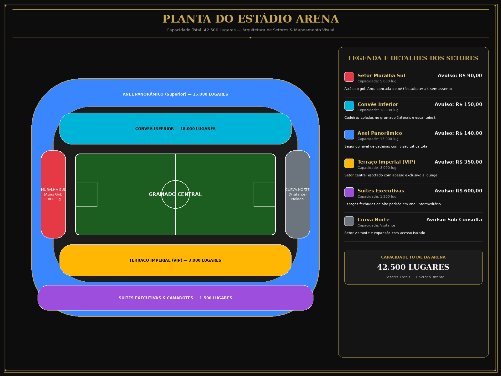
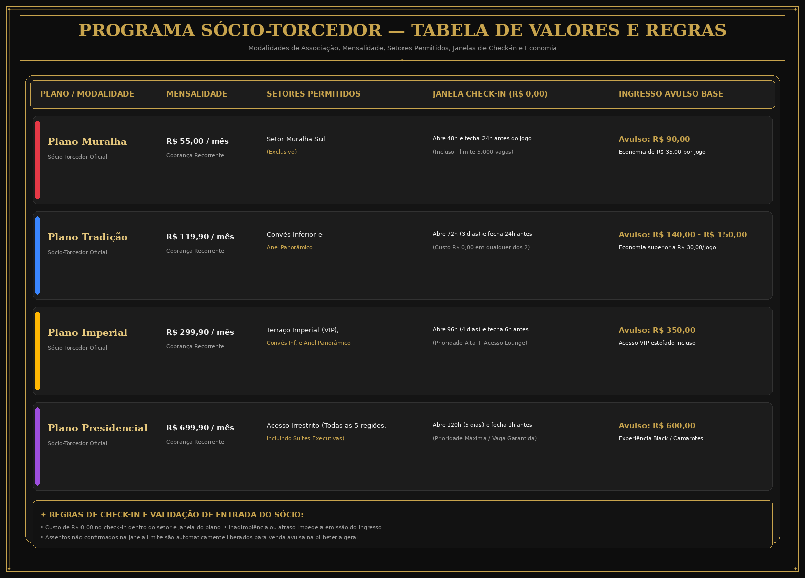

# 🏟️ Sistema de Gestão Sócio-Torcedor — Arena Atlântico

Sistema completo de gerenciamento de **Sócio-Torcedor e Check-in de Partidas** da **Arena Atlântico**, desenvolvido em **Java 25** com persistência em banco de dados relacional **PostgreSQL (via JDBC)**, aplicando boas práticas de **Programação Orientada a Objetos (POO)**, padrões de projeto (**DAO** e **Factory**) e arquitetura em camadas.

---

## 🗺️ Planta de Setores — Arena Atlântico



| Setor (`RegiaoEstadio`) | Capacidade | Preço Avulso | Observação |
| :--- | :---: | :---: | :--- |
| **Muralha-Sul** (`MURALHA_SUL`) | 5.000 lugares | R$ 90,00 | Setor Popular / Geral |
| **Convés-Inferior** (`CONVES_INFERIOR`) | 18.000 lugares | R$ 150,00 | Arquibancada Inferior |
| **Anel-Panorâmico** (`ANEL_PANORAMICO`) | 15.000 lugares | R$ 140,00 | Arquibancada Superior |
| **Terraço-Vip** (`TERRACO_VIP`) | 3.000 lugares | R$ 350,00 | Setor VIP Central |
| **Suítes-Executivas** (`SUITES_EXECUTIVAS`) | 1.500 lugares | R$ 600,00 | Camarotes Fechados |
| **Curva-Norte** (`CURVA_NORTE`) | 2.000 lugares | R$ 100,00 | Torcida Visitante (Bloqueado para sócios) |

---

## 💳 Tabela de Planos, Valores e Janelas de Check-in



Cada modalidade de plano implementa a interface [`ModalidadeSocio`](src/main/java/br/com/arena/model/planos/ModalidadeSocio.java), definindo polimorficamente os setores permitidos e a prioridade na abertura/fechamento do check-in:

| Plano | Mensalidade | Setores Liberados para Check-in | Abertura do Check-in | Fechamento do Check-in |
| :--- | :---: | :--- | :---: | :---: |
| **Plano Muralha** | R$ 45,00/mês | `MURALHA_SUL` | **48h** antes da partida | **24h** antes da partida |
| **Plano Tradição** | R$ 110,00/mês | `CONVES_INFERIOR`, `ANEL_PANORAMICO` | **72h** antes da partida | **24h** antes da partida |
| **Plano Imperial** | R$ 260,00/mês | `TERRACO_VIP`, `CONVES_INFERIOR`, `ANEL_PANORAMICO` | **96h** antes da partida | **6h** antes da partida |
| **Plano Presidencial** | R$ 550,00/mês | Todos os setores da casa (exceto `CURVA_NORTE`) | **120h** antes da partida | **1h** antes da partida |

---

## ⚙️ Regras de Negócio Validadas (`ServicoCheckin`)

1. **Autenticação e Cadastro Único:** O sócio realiza cadastro ou login via **CPF e Senha**, não sendo permitido duplicar CPFs no banco nem visualizar dados de outros sócios.
2. **Validação de Status:** Apenas sócios com status `ATIVO` podem realizar check-in (sócios `INADIMPLENTE` ou `SUSPENSO` são bloqueados).
3. **Permissão de Setor por Plano:** O sistema valida via polimorfismo (`acessoDoPlano`) se o plano do sócio dá direito ao setor escolhido; o setor `CURVA_NORTE` (visitante) é bloqueado para todos os planos.
4. **Janela Temporal de Prioridade:** O check-in só é aceito se o horário atual (`LocalDateTime.now()`) estiver dentro da janela `[inicioCheckin, fimCheckin]` calculada pelo plano do sócio em relação à data/hora da partida.
5. **Bloqueio de Duplicidade:** O sócio não pode realizar mais de um check-in para a mesma partida (validado no `CheckinDAO` e garantido por constraint `UNIQUE (socio_id, partida_id)` no PostgreSQL).
6. **Controle de Lotação:** Antes de confirmar o check-in, o banco contabiliza a ocupação atual daquele setor na partida e bloqueia caso atinja a capacidade máxima do `RegiaoEstadio`.

---

## 🏗️ Arquitetura do Projeto

```text
src/main/java/br/com/arena/
├── Main.java                          # Portal interativo de console (Login, Cadastro e Check-in)
├── config/
│   ├── FabricaConexao.java            # Connection Factory JDBC (lê credenciais de db.properties / ENV)
│   └── InicializadorBanco.java        # Cria automaticamente o banco arena_db e as tabelas SQL (DDL)
├── dao/
│   ├── SocioDAO.java                  # Persistência e busca de sócios por CPF (PreparedStatement)
│   ├── PartidaDAO.java                # Persistência e listagem de partidas disponíveis
│   └── CheckinDAO.java                # Registro de check-ins, verificação de duplicidade e lotação
├── model/
│   ├── Socio.java                     # Entidade Sócio
│   ├── Partida.java                   # Entidade Partida
│   ├── Checkin.java                   # Entidade Check-in
│   ├── enums/
│   │   ├── RegiaoEstadio.java         # Enum com nome, capacidade e preço de cada setor
│   │   └── StatusSocio.java           # Enum (ATIVO, INADIMPLENTE, SUSPENSO)
│   └── planos/
│       ├── ModalidadeSocio.java       # Interface de contrato dos planos (Strategy / Polimorfismo)
│       ├── FabricaPlano.java          # Factory para reconstruir o plano a partir do banco de dados
│       ├── PlanoMuralha.java
│       ├── PlanoTradicao.java
│       ├── PlanoImperial.java
│       └── PlanoPresidencial.java
└── service/
    └── ServicoCheckin.java            # Camada de regras de negócio e orquestração do check-in
```

---

## 🚀 Como Executar o Projeto

### Pré-requisitos
- **Java JDK 25** (ou compatível)
- **Maven**
- **PostgreSQL** rodando localmente na porta `5432`

### 1. Configurar as credenciais do Banco (Segurança)
Para evitar exposição de senhas no Git, as credenciais ficam no arquivo local `db.properties` (ignorado pelo `.gitignore`).
Copie o arquivo de exemplo [`db.properties.example`](db.properties.example) para `db.properties` na raiz do projeto e informe sua senha do PostgreSQL:

```properties
db.user=postgres
db.password=sua_senha_do_postgres
```

### 2. Executar a aplicação
Basta executar a classe [`Main.java`](src/main/java/br/com/arena/Main.java) pela sua IDE (IntelliJ IDEA).
Na primeira execução, o [`InicializadorBanco`](src/main/java/br/com/arena/config/InicializadorBanco.java) criará automaticamente:
- O banco de dados **`arena_db`**;
- As tabelas **`socios`**, **`partidas`** e **`checkins`**;
- As partidas iniciais do calendário para teste imediato no console.
